# UI audit, October 2026

Scope: every marketing page and the main product screens, captured with `packages/frontend/scripts/ui-screens.mjs`
at 1440, 1024 and 390 wide in light and dark (150 screenshots), on a freshly seeded demo company (cloud edition).
Each finding names the rule in [`design-system.md`](design-system.md) it breaks, or the usability reason. Selected
before/after pairs are at the end.

Machine checks on the before set: horizontal overflow on 2 of 150 screens (payroll run at 390, both themes). Console
errors: none from the app itself; the only errors were the local auth stub refusing the realtime websocket (a test
environment artefact) and the expected 404 status on the 404 page. Code checks: no `font-medium`, no Tailwind default
text sizes, no gradients, one shadow token, no hard-coded colours in components, no em or en dashes in visible copy.

Lighthouse, mobile, before: `/` Performance 78, Accessibility 100, Best Practices 100, SEO 100 (LCP 4.2 s, CLS 0);
`/pricing` 96 / 92 / 100 / 100 (LCP 2.8 s, CLS 0).

## Marketing

### Home (`/`)
1. **Product shots below the hero can render as empty tiles.** The `reveal` animation starts from `opacity: 0` and only
   reaches full opacity as a scroll timeline advances. A full-page capture (and any browser or tool that never advances
   the timeline) shows the compliance, payroll and mobile tiles blank. Usability: the page's evidence disappears.
2. **Three of ten modules are visible to a buyer.** Payroll, compliance and mobile self-service are shown; leave,
   attendance, onboarding and exits, expenses, helpdesk, recruitment, performance and analytics are in the product
   (`nav.constants.ts`) but nowhere on the page. Usability: buyers cannot tell the suite covers them.
3. **The hero screenshot is unreadable on a phone.** A 2880 px desktop dashboard shrunk to 358 px wide; nothing in it
   can be read at 390. Usability.
4. **Every screenshot ships at full 2880 px to every device.** Lighthouse: 309 KiB of oversized images, LCP 4.2 s on
   mobile (target 2.5 s). Performance target.
5. **The law chips are one undifferentiated cloud** of eight items; a CA scanning for "income tax" or "state rules" has
   to read all of them. Usability.
6. **No price on the page beyond one sentence**, and no answers to the obvious questions (GST, data location, trial).
   Usability: the buyer has to leave the page to decide.
7. **Brand link's accessible name does not contain its visible text** ("JH" inside `aria-label="JantaHR home"`).
   Lighthouse `label-content-name-mismatch`; WCAG 2.5.3.

### Global nav and sub-nav (all marketing pages)
8. **No selected state** on the current page in the black bar. Rule 12 (navigation must show where you are).
9. **No mobile menu.** Under 640 px the bar hides Compliance and Self-hosting; Developers and About are unreachable
   except through the footer. Usability.

### Footer (all marketing pages)
10. **The contact email breaks inside the domain** on phones (`jantahr@devshipit.co` / `m`) because the link uses
    `break-all`. Usability.
11. **Wrapped footer links look like two links** ("Cancellation and" / "refunds"): `text-dense-link` has 2.41 line
    height, so a wrapped label leaves a full blank line inside one link. Usability.

### Pricing (`/pricing`)
12. **Unselected billing-cycle segment fails contrast**: `#6e6e72` on `#f0f0f0` is 4.45:1 (needs 4.5:1). WCAG 1.4.3;
    Lighthouse Accessibility 92.
13. **Inline link relies on colour alone** ("Setup guide" in muted text, 1.09:1 against the surrounding text).
    WCAG 1.4.1; Lighthouse `link-in-text-block`.
14. **Employee count accepts anything typed** (clamps silently, no message) and the chosen cycle and count are lost on
    reload or when the link is shared. Usability.
15. **"Compare every feature" is a table that scrolls sideways on phones**, with no sticky header on long scroll.
    Usability.

### Legal and long-form pages (terms, privacy, refunds, shipping, about, developers)
16. **Measure runs to about 90 characters at 1440** (760 px column of 17 px text). Comfortable reading is 68 to 72.
    Usability.
17. **Inline links in body text are colour-only** (same as 13). WCAG 1.4.1.

### Contact (`/contact`)
18. No form on the page, so the form rules do not apply. Contact details are a definition list; fine. Same footer
    issues as 10 and 11.

### 404
19. **Unbranded framework 404** ("404 | This page could not be found.") with no navigation, no link home, to pricing
    or to sign in. Usability: a dead end.

## Product

### Shared patterns
20. **Dates read "10 Sept 2022"**: `toLocaleDateString('en-IN', { month: 'short' })` returns "Sept" in current ICU,
    so September differs from every other month. Pay months are written in full ("September 2026") in some places and
    the date input shows the browser's own format. Consistency.
21. **Segmented controls wrap into a blob on phones** (attendance, leave, settings, approvals, employee detail pass
    `flex-wrap` to `TabsList`): three rows of tabs inside one pill. Rule 7 (pill shape) and usability.
22. **Wide tables on phones squeeze the first column** (payroll run, attendance, compliance): names wrap over three
    lines and the last column or the row action is cut off at the edge. Usability.
23. **Table headers scroll away** on long lists (employees, payroll run). Usability: column meaning is lost after
    one screen.
24. **The floating Help button covers row content** at 390 (counts, statuses, row actions) and there is no bottom
    padding to scroll past it. Usability; WCAG 2.4.11 (focus not obscured) for the covered row actions.

### Dashboard (admin)
25. Hierarchy is right on desktop (attention items in the first row of cards). On phones the stat cards come before
    "Pending with HR" and "Statutory deadlines", so the things that need action today are two screens down.
    Usability.

### Employee detail
26. **Raw enum values**: gender "MALE", marital status "MARRIED", role "super admin" (lower case). Consistency.
27. **Joined date split across two lines** ("17 Oct" / "2019") in the stat card. Consistency with the date format.

### Payroll run
28. **Progress steps overflow the viewport at 390** ("Paid" is cut and the page scrolls sideways). Horizontal
    overflow.
29. **Paid days below the month length are shown in red only** (29.5, 27): meaning carried by colour alone. WCAG 1.4.1.

### Compliance calendar
30. Row action ("Mark filed") is cut off at 390 (see 22).

### Billing
31. **Notices use a tinted warning fill** (`bg-warning/10` with a warning border). Rule 3b (notices are neutral).

### Employees, attendance, leave, payroll runs, salary setup, approvals, settings, payslips
32. Page headers, empty states, loading skeletons and inline errors are already consistent: every list page uses
    `PageHeader`, `DataTable` or `QueryBoundary`. Detail pages (employee, payroll run) build their own title row,
    which is acceptable for a record header but drifts in spacing from `PageHeader`. Status chips follow rule 2.

## Dark mode
33. Parity is good: no hard-coded colours. The dark tile behind the compliance shot and the closing band read as one
    block when the shot is missing (see 1).

## What changed, finding by finding

| # | Finding | Result |
|---|---|---|
| 1 | Product shots can render blank | Fixed: `reveal` animates transform only (rule 15) |
| 2 | Most modules invisible to a buyer | Fixed: "Everything around payroll", one cell per module, plan from the catalogue |
| 3 | Hero shot unreadable on a phone | Improved: a product tour with a Mobile view; the Overview view is still a desktop screen (see open questions) |
| 4 | 2880 px images on every device | Fixed: srcset with 640, 1080 and 1600 px copies |
| 5 | Law chips in one cloud | Fixed: four labelled clusters, every item kept |
| 6 | No prices or answers on the page | Fixed: pricing teaser and five questions, with FAQPage JSON-LD |
| 7 | Brand link name mismatch | Fixed: visible-text name, no aria-label |
| 8 | No selected state in the nav | Fixed: `aria-current` and a stronger label |
| 9 | No phone menu | Fixed: sheet menu, focus trapped, Escape closes, 44 px links |
| 10 | Email breaks mid-domain | Fixed: full-width contact column on phones, `overflow-wrap: anywhere` as a last resort |
| 11 | Wrapped footer links look like two | Fixed: normal leading and 44 px targets under 640 px |
| 12 | Billing toggle contrast 4.45:1 | Fixed here and in every segmented control (shared Tabs) |
| 13, 17 | Colour-only inline links | Fixed: underlined inline links |
| 14 | Employee count clamps silently, state lost | Fixed: whole numbers 1 to 1,00,000 with an inline error; state in `?billing=&employees=` |
| 15 | Comparison table sideways on phones | Fixed: sticky header from 768 px, one card per plan on phones |
| 16 | 90 character measure | Fixed: 70 characters at 17 px, "On this page" over 1,500 words |
| 18 | No contact form | Added: a form that mails the support address, with validation, sending and success states |
| 19 | Framework 404 | Fixed: branded 404 with links home, to pricing and to sign in |
| 20 | "Sept" and mixed date formats | Fixed: one helper (rule 16) |
| 21 | Segmented controls wrap on phones | Fixed: they scroll |
| 22 | Squeezed or cut table columns | Fixed: first column pinned, readable column widths, scroll inside the card |
| 23 | Headers scroll away | Fixed: sticky header from 1024 px |
| 24 | Help button covers content | Kept: the page already ends with room to scroll past it; the save bar is padded clear of it |
| 25 | Attention items two screens down | Fixed: pending requests and deadlines first |
| 26, 27 | Raw enum values, split dates | Fixed |
| 28 | Payroll steps overflow at 390 | Fixed |
| 29 | Paid days in red only | Fixed: "LOP 0.5" beside the number |
| 31 | Tinted notice on Billing | Fixed: neutral surface, coloured icon (rule 3b) |

## Before and after

Machine checks on the same 150 screens: horizontal overflow on 2 before, **0 after**. App console errors: a hydration
warning on Billing before (a `div` badge inside a `p`), **none after**; the only remaining console lines come from
the local test setup (no realtime server) and the 404 page's own status.

Lighthouse, mobile, median of three runs on a local production build (`next start`, simulated slow 4G and 4x CPU):

| Page | | Performance (runs) | Accessibility | Best Practices | SEO | LCP | CLS |
|---|---|---|---|---|---|---|---|
| / | Before | 89 (89, 89, 89) | 100 | 100 | 100 | 3.7 s | 0.00 |
| / | After | 96 (96, 96, 96) | 100 | 100 | 100 | 2.7 s | 0.00 |
| /pricing | Before | 99 (99, 96, 99) | 92 | 100 | 100 | 2.3 s | 0.00 |
| /pricing | After | 98 (98, 99, 98) | 100 | 100 | 100 | 2.3 s | 0.00 |

Home LCP fell from 3.7 s to 2.7 s: phones now get a 640 or 1080 px hero instead of 2880 px, and the marketing pages
no longer load the signed-in app's session and API code (the root layout carried about 390 KB of uncompressed
JavaScript for it). Pricing stays at 2.3 s while gaining the comparison table and the URL state. Home is still 0.2 s
over the 2.5 s target in this simulation: the hero image arrives early, and what holds the paint back is the
framework's own JavaScript (React and the Next.js runtime, shared by every page). Production numbers on Vercel's CDN
should be measured after deploy.

| Screen | Before | After |
|---|---|---|
| Home, 1440, light | 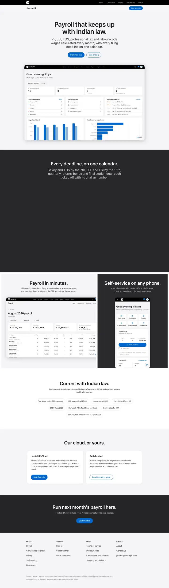 | 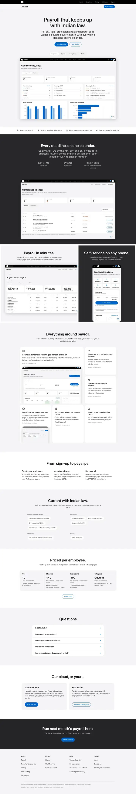 |
| Home, 390, light | 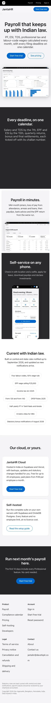 |  |
| Home, 1440, dark | 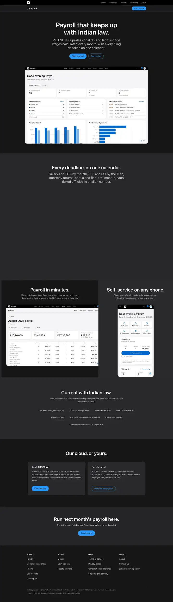 | 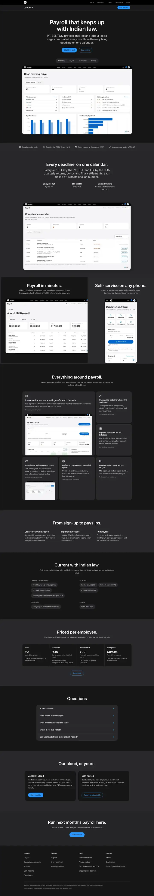 |
| Pricing, 390 | 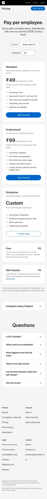 | 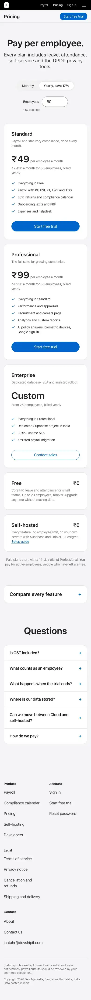 |
| Contact, 1440 | 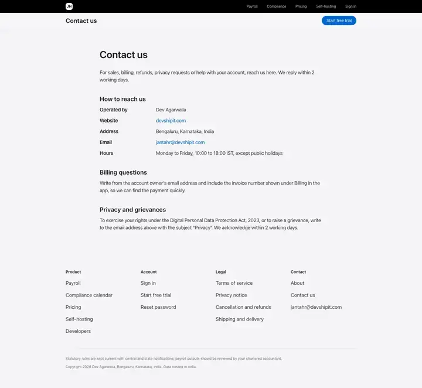 | 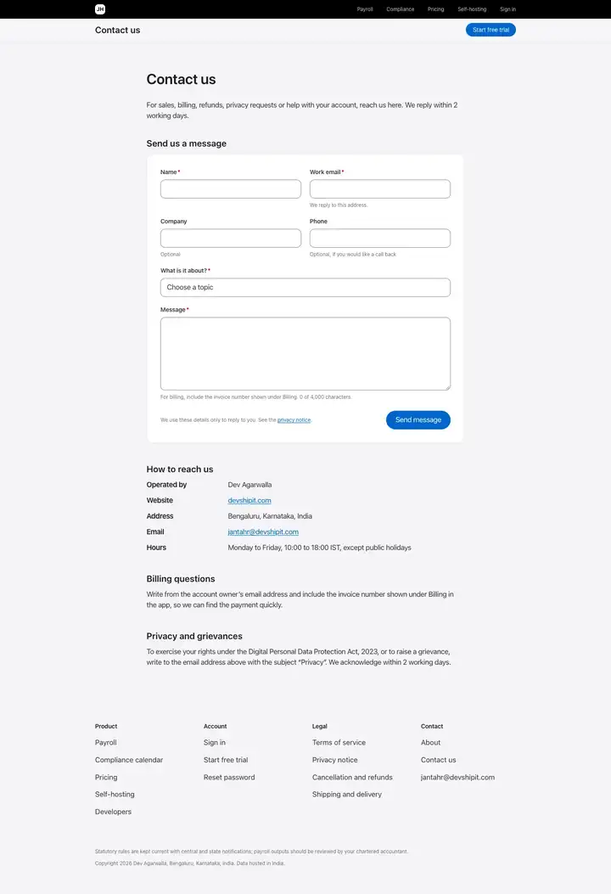 |
| 404, 1440 | 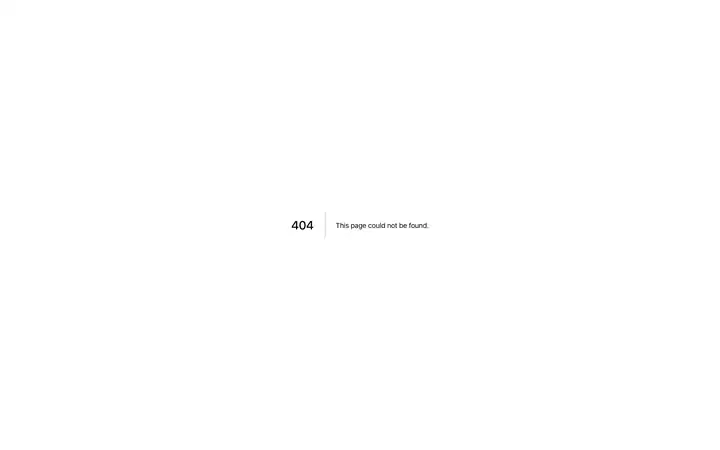 |  |
| Terms, 1440 | 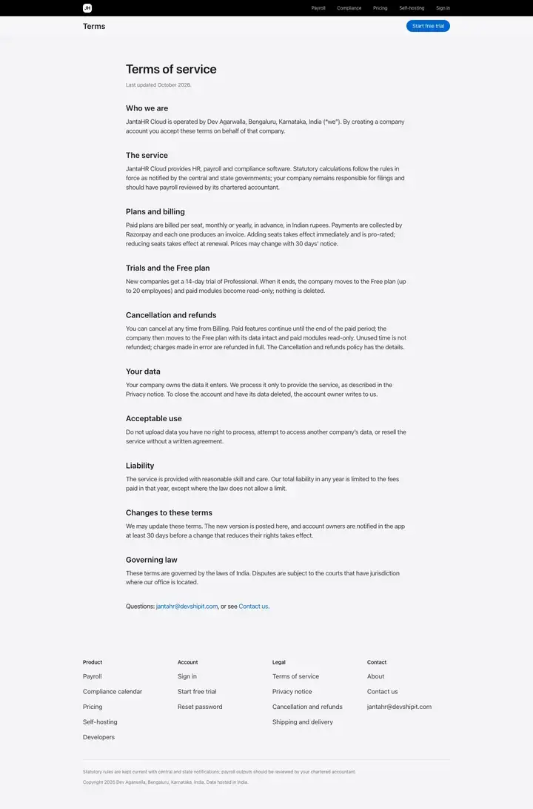 |  |
| Dashboard, 1440 | 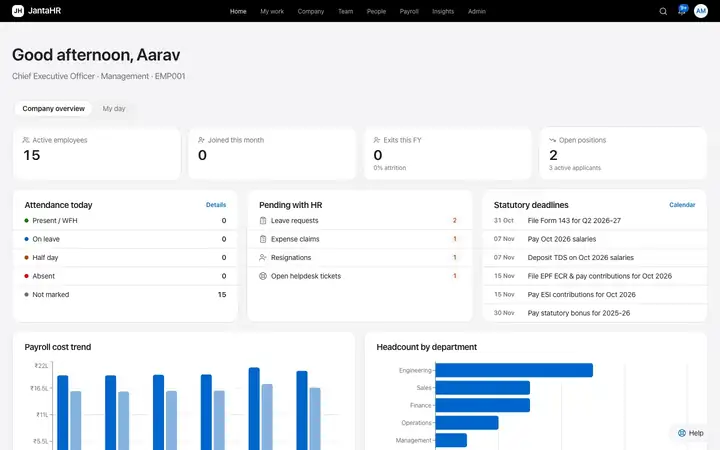 | 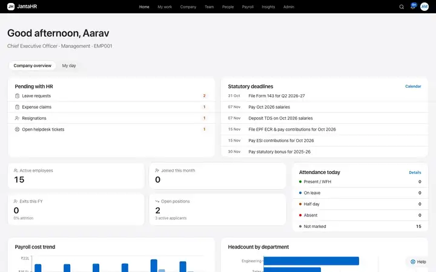 |
| Employee detail, 1440 | 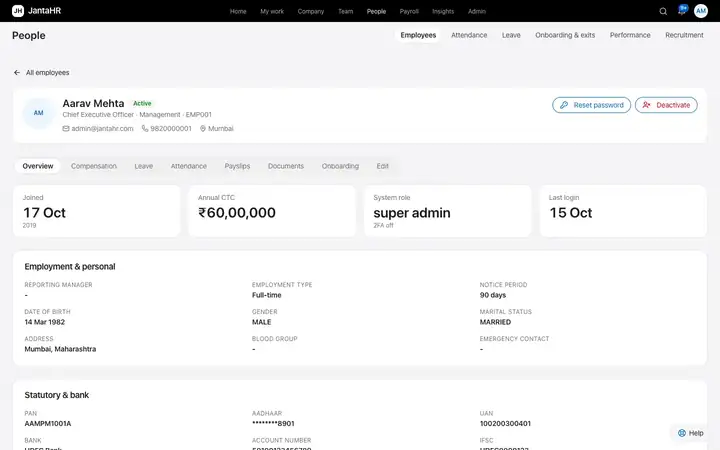 | 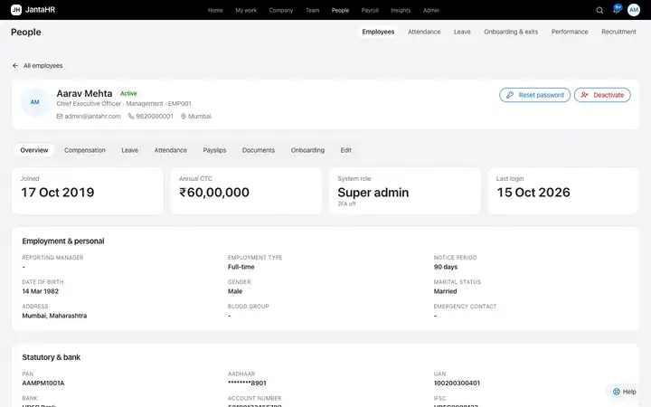 |
| Payroll run, 390 | 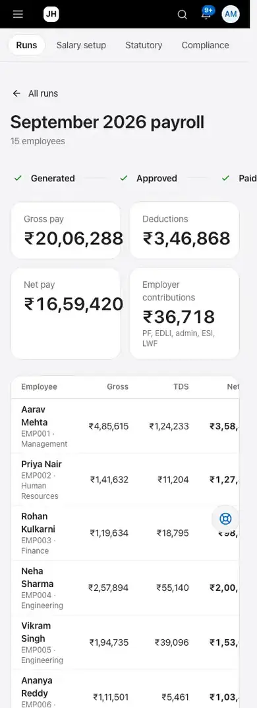 | 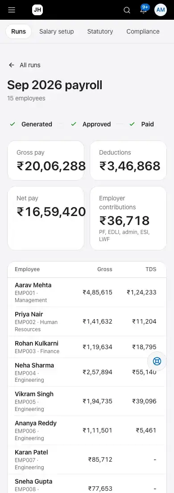 |
| Compliance, 390 | 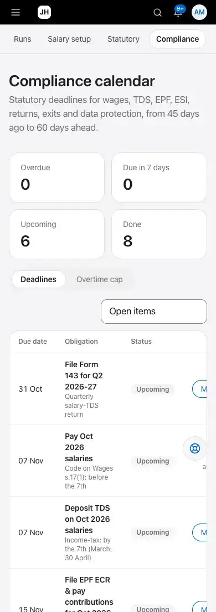 | 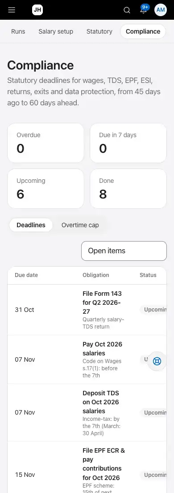 |
| Attendance, 390 | 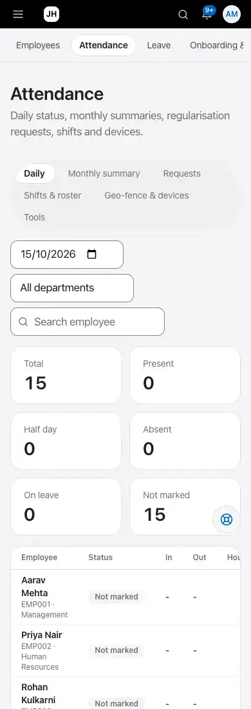 | 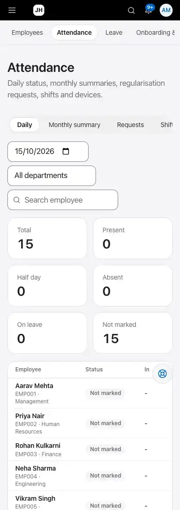 |

The full sets (150 screenshots each, with `report.json`) are reproducible with
`OUT=<dir> node packages/frontend/scripts/ui-screens.mjs` against a seeded cloud-edition build.
